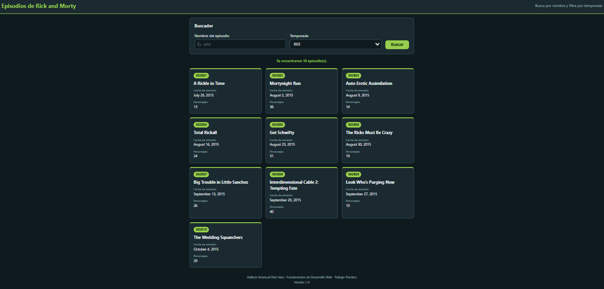

# Buscador de episodios · Rick and Morty

Aplicación web de una sola pantalla que permite buscar episodios de la serie
Rick and Morty por nombre y filtrarlos por temporada, consumiendo la API
pública de la serie. Resuelve el problema de encontrar rápidamente un episodio
y ver sus datos principales sin recorrer listados extensos.

**Autor:** Adilson Emanuel Diaz Vera · Fundamentos de Desarrollo Web · UCSA
**Variante del TP:** C · Episodios

## Sitios publicados

- GitHub Pages: https://adilson-git.github.io/tp-diaz-adilson/
- Vercel: https://tp-diaz-adilson.vercel.app/

## Captura



## Funcionalidades

- Búsqueda de episodios por nombre.
- Filtro por temporada (S01 a S05) mediante una lista desplegable.
- Combinación del nombre y la temporada en una misma petición a la API.
- Tarjetas con nombre, código del episodio, fecha de emisión y cantidad de personajes.
- Mensajes de estado: «Buscando…», sin resultados (404), error de conexión y aviso cuando no hay criterios.
- Botón de búsqueda deshabilitado mientras se espera la respuesta.
- Memoria de la última búsqueda con `localStorage`: al recargar se restauran los campos y se repite la búsqueda.
- Diseño responsive con CSS Grid, Flexbox y variables CSS.
- Número de versión visible en el pie de página.

## Tecnologías

- HTML5 semántico
- CSS3 (Grid, Flexbox, variables CSS, diseño responsive)
- JavaScript (ES6+), Fetch API, `async/await`, `localStorage`
- [API de Rick and Morty](https://rickandmortyapi.com/documentation) (endpoint `/episode`)
- Git y GitHub, GitHub Pages y Vercel

## Estructura del proyecto

```
tp-diaz-adilson/
├── index.html        Estructura de la página: encabezado, buscador, resultados y pie
├── README.md         Documentación técnica del proyecto
├── .gitignore        Archivos que Git no debe registrar
├── css/
│   └── estilos.css   Estilos: variables, grilla de tarjetas y diseño responsive
├── js/
│   └── app.js        Lógica: petición a la API, tarjetas, estados y localStorage
└── img/
    └── captura.png   Captura de pantalla mostrada en este README
```

## Cómo ejecutarlo localmente

1. Clonar el repositorio:
   ```
   git clone https://github.com/Adilson-GIT/tp-diaz-adilson.git
   ```
2. Abrir `index.html` en el navegador (o con la extensión Live Server de VS Code).

No requiere instalar dependencias ni ejecutar ningún paso de compilación.

## Despliegue

El sitio es estático y se publica desde la rama `main`, carpeta raíz, en dos
plataformas: **GitHub Pages** y **Vercel** (preset «Other», sin comando de
compilación). Ambas están conectadas al repositorio, así que cada `git push` a
`main` actualiza automáticamente las dos URL, sin subir archivos a mano.
